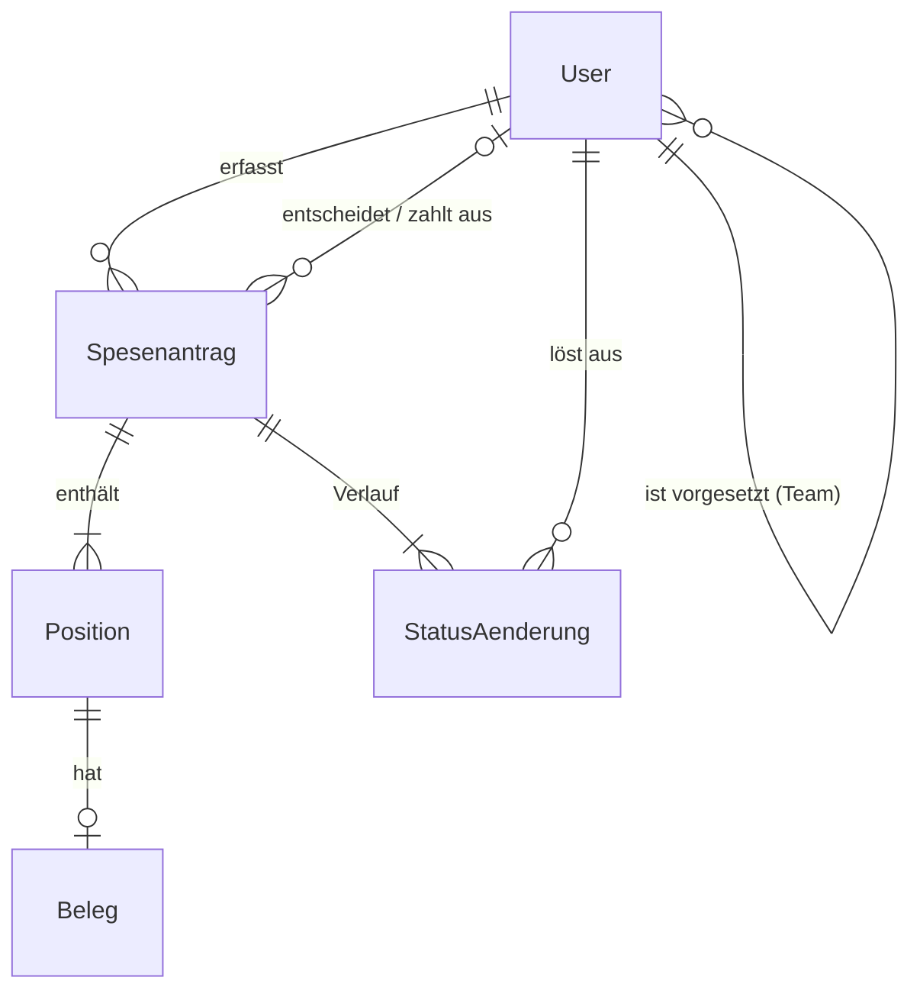
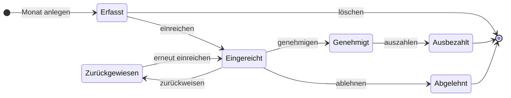
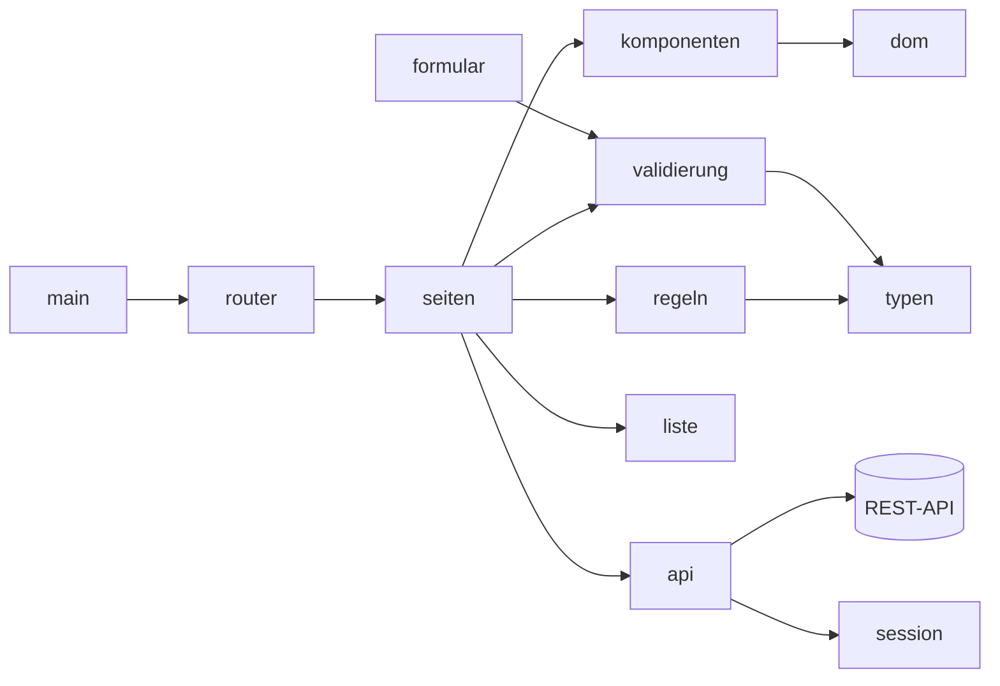

# Spesenportal

Digitales Spesenportal – Projekt «Digitalisierter Geschäftsprozess» in WEB I und DTR II (gibb HF).

**Gruppenname:** Team Spesenportal
**Mitglieder:** Parwar Habasch, Felix Stalder, Pakierthan Pakeerathan
**Repository:** https://github.com/pak111-jpg/WEB_Spesentool

## Projekt

Bisher liefen Spesen über Excel, Papierbelege und E-Mail: Dieselben Daten wurden dreimal erfasst, Belege
gingen verloren und niemand sah, wo ein Antrag steht. Im Spesenportal erfassen Mitarbeitende ihre Auslagen
pro Monat mit einem Foto oder PDF des Belegs; Totale und Kilometerpauschalen rechnet das System. Die
Monatsabrechnung wird mit einem Klick eingereicht, und die vorgesetzte Person prüft sie am Bildschirm:
genehmigen, mit Begründung zurückweisen oder ablehnen. Die Lohnbuchhaltung exportiert die genehmigten
Abrechnungen als CSV-Datei für das Lohnsystem und markiert sie als ausbezahlt, damit nichts doppelt
ausbezahlt wird.

**Inhalt:** [Start](#start) · [Technik](#technik) · [Daten und Status](#daten-und-status) ·
[Struktur](#struktur) · [User Stories](#abdeckung-der-user-stories) · [Testdaten](#testdaten) ·
[Tests](#automatisierte-tests) · [Aufgaben](#aufgabenverteilung) · [Abweichungen](#abweichungen) ·
[KI-Deklaration](#ki-deklaration) · [Quellen](#quellen) · [Bonus](#bonus) ·
[Nachweis Basisanforderungen](#nachweis-basisanforderungen)

Die Spezifikation aus DTR II liegt im Ordner [`docs`](docs): [User Stories mit Akzeptanzkriterien](docs/user-stories.md),
[Zustandsdiagramm](docs/zustandsdiagramm.md) und die Original-PDFs in [`docs/dtr2`](docs/dtr2).

## Start

### Voraussetzungen

- **Node.js 24** (LTS, empfohlen; die Anwendung läuft ab 22.12, die automatischen Tests brauchen 24.9)
- **Docker Desktop**, gestartet (für die Datenbank MariaDB)
- **Git**
- Freie Ports: 3000 (Backend), 5173 (Frontend), 53306 (Datenbank)

### In drei Schritten (ca. 3 Minuten)

```bash
git clone https://github.com/pak111-jpg/WEB_Spesentool.git
cd WEB_Spesentool
npm run setup    # einmalig: .env anlegen, Pakete installieren, Datenbank starten, Tabellen und Demo-Daten laden
npm start        # startet Backend (Port 3000) und Frontend (Port 5173) zusammen
```

Danach im Browser (aktuelles Chrome oder Firefox) **http://localhost:5173** öffnen.
Die REST-API mit Dokumentation (Swagger) ist unter http://localhost:3000/api erreichbar.

| Aufgabe | Befehl |
| ------- | ------ |
| Demo-Daten zurücksetzen | `npm run seed` |
| Anwendung stoppen | `Ctrl + C` im Terminal von `npm start` |
| Datenbank stoppen | `npm --prefix backend run db:down` |
| Tests ausführen | `npm test` (Unit) und `npm run test:e2e` (braucht laufende Datenbank mit Demo-Daten) |

**Ohne Docker:** eine eigene MariaDB oder MySQL verwenden, `DATABASE_URL` in `backend/.env` anpassen und
danach `npm --prefix backend run db:migrate` und `npm run seed` ausführen.

### Testzugänge und Rollenwechsel

Passwort für alle: **`passwort`**. Die Rolle wechselt man mit **Abmelden** (oben rechts) und erneutem Anmelden.
Auf der Anmeldeseite füllen die Knöpfe unter **«Demo-Zugänge»** E-Mail und Passwort aus.

| E-Mail | Rolle | Was man damit ausprobieren kann |
| ------ | ----- | ------------------------------- |
| anna.meier@firma.ch | Mitarbeitende (Team Beat) | Abrechnung des laufenden Monats: eine Position ohne Beleg → Einreichen zeigt den Fehler |
| eva.brunner@firma.ch | Mitarbeitende (Team Sandra) | zurückgewiesene Abrechnung mit Benachrichtigung, korrigieren und erneut einreichen |
| carla.huber@firma.ch, daniel.frei@firma.ch, marco.rossi@firma.ch | Mitarbeitende | weitere Anträge in allen Status |
| beat.keller@firma.ch | Vorgesetzte (Team Anna, Carla, Daniel) | offene Anträge, einer davon überfällig; prüfen und entscheiden |
| sandra.weber@firma.ch | Vorgesetzte (Team Eva, Marco) | erneut eingereichter Antrag mit längerem Verlauf |
| lena.schmid@firma.ch | Lohnbuchhaltung | genehmigte Abrechnungen des Vormonats exportieren und auszahlen, Auswertung pro Kostenstelle |

**Ganzer Prozess in 3 Minuten:** Anna ergänzt den fehlenden Beleg und reicht ein → Beat weist mit Begründung
zurück → Anna sieht die Benachrichtigung, korrigiert und reicht erneut ein → Beat genehmigt → Lena wählt den
laufenden Monat, exportiert die CSV-Datei und markiert die Abrechnung als ausbezahlt. Der Verlauf in der
Detailansicht zeigt jeden Schritt mit Zeitpunkt, Person und Rolle.

## Technik

| Bereich | Technik |
| ------- | ------- |
| Frontend | HTML, CSS und **TypeScript** (wird zu JavaScript übersetzt) als ES-Module, **ohne JavaScript- oder CSS-Framework**. Die Oberfläche entsteht mit `document.createElement`, die Navigation mit einem eigenen Hash-Router. |
| Build-Werkzeug Frontend | Vite 8 (Entwicklungsserver und Übersetzung von TypeScript) |
| Backend | Node.js mit NestJS 12 (REST-API), TypeScript, Validierung mit class-validator, OpenAPI/Swagger |
| Datenbank | MariaDB 11 (in Docker), Zugriff mit Prisma 7 (ORM und Migrationen) |
| Anmeldung | JWT (Bearer-Token), Passwörter mit bcrypt gehasht, Rollen werden im Backend geprüft |
| Tests | Jest (Unit- und End-to-End-Tests über die REST-API), Supertest |
| Codequalität | ESLint (mit Regeln aus dem Bewertungsraster, siehe Nachweis), Prettier, TypeScript im Modus `strict` |

**TypeScript statt JavaScript:** TypeScript ist JavaScript mit Typangaben; der Browser führt das übersetzte
JavaScript aus. Wir verwenden es, damit Frontend und Backend dieselbe Sprache haben und Fehler schon beim
Übersetzen auffallen. Es ist kein Framework. ⚠️ *Vor der Abgabe mit der Lehrperson bestätigen (A03).*

## Daten und Status

### Datenmodell



| Entität | Felder | Beziehungen |
| ------- | ------ | ----------- |
| **User** (Person) | `id`, `personalnummer` (eindeutig), `email` (eindeutig), `name`, `passwortHash`, `rolle` (MITARBEITENDE, VORGESETZTE, LOHNBUCHHALTUNG), `kostenstelle`, `vorgesetzteId`, `erstelltAm` | gehört zu höchstens einer vorgesetzten Person (Team); hat viele Anträge |
| **Spesenantrag** (Monatsabrechnung) | `id`, `jahr`, `monat`, `status`, `mitarbeitendeId`, `eingereichtAm`, `entschiedenVonId`, `entschiedenAm`, `begruendung`, `ausbezahltVonId`, `ausbezahltAm`, `erstelltAm`, `geaendertAm` | genau ein Antrag pro Person und Monat (`@@unique(mitarbeitendeId, jahr, monat)`); hat viele Positionen und Verlaufseinträge |
| **Position** | `id`, `antragId`, `datum`, `kategorie` (FAHRT, VERPFLEGUNG, UEBERNACHTUNG, MATERIAL), `zweck`, `kilometer` (nur Fahrt), `betrag` | gehört zu einem Antrag; hat höchstens einen Beleg |
| **Beleg** | `id`, `positionId` (eindeutig), `dateiname`, `mimeType`, `groesse`, `pfad`, `hochgeladenAm` | gehört zu genau einer Position; die Datei liegt in `backend/uploads/` |
| **StatusAenderung** (Verlauf) | `id`, `antragId`, `vonStatus`, `nachStatus`, `zeitpunkt`, `userId`, `rolle`, `begruendung` | gehört zu einem Antrag und der Person, die den Wechsel ausgelöst hat |

Berechnete Werte werden nicht gespeichert: Das **Total** eines Antrags ist die Summe der Positionen, der
Betrag einer **Fahrt** ist Kilometer × Pauschale (`KILOMETERPAUSCHALE_CHF`, Standard 0.70). Das vollständige
Schema steht in [`backend/prisma/schema.prisma`](backend/prisma/schema.prisma).

### Statusmodell



| Von | Nach | Ereignis | Rolle | Bedingung |
| --- | ---- | -------- | ----- | --------- |
| – | Erfasst | Monat anlegen | Mitarbeitende | noch keine Abrechnung für diesen Monat |
| Erfasst | (gelöscht) | löschen | Mitarbeitende | – |
| Erfasst, Zurückgewiesen | Eingereicht | einreichen | Mitarbeitende | jede Position hat Datum, Betrag > 0, Zweck und Beleg; vorgesetzte Person zugeordnet |
| Eingereicht | Genehmigt | genehmigen | Vorgesetzte des Teams | – |
| Eingereicht | Zurückgewiesen | zurückweisen | Vorgesetzte des Teams | Begründung mind. 5 Zeichen |
| Eingereicht | Abgelehnt | ablehnen | Vorgesetzte des Teams | Begründung mind. 5 Zeichen |
| Genehmigt | Ausbezahlt | als ausbezahlt markieren | Lohnbuchhaltung | einzeln oder ganzer Monat |

Alle anderen Übergänge sind unzulässig: Die Oberfläche zeigt dafür keine Knöpfe, und das Backend antwortet
mit `409 Conflict`. Jeder Wechsel wird mit Zeitpunkt, Person und Rolle im Verlauf gespeichert und in der
Detailansicht angezeigt. Ausführlich: [`docs/zustandsdiagramm.md`](docs/zustandsdiagramm.md).

### Wer sieht was

| Rolle | sieht | darf |
| ----- | ----- | ---- |
| Mitarbeitende | nur eigene Anträge | erfassen, bearbeiten (Erfasst, Zurückgewiesen), einreichen, löschen (Erfasst) |
| Vorgesetzte | eingereichte und entschiedene Anträge des eigenen Teams, keine Entwürfe | genehmigen, zurückweisen, ablehnen |
| Lohnbuchhaltung | nur genehmigte und ausbezahlte Abrechnungen | exportieren, als ausbezahlt markieren, auswerten |

## Struktur

```
WEB_Spesentool/
├── package.json            npm run setup / npm start / npm test für das ganze Projekt
├── scripts/setup.mjs       Ersteinrichtung (Windows, macOS, Linux)
├── docs/                   Spezifikation aus DTR II und Nachweise
├── backend/                REST-API (NestJS), Details in backend/README.md
│   ├── prisma/             schema.prisma, Migrationen, Demo-Daten (seed*.ts)
│   ├── src/auth            Anmeldung, JWT
│   ├── src/common          Guards für Anmeldung und Rollen, Decorators
│   ├── src/antraege        Anträge der Mitarbeitenden, statusregeln.ts, statuswechsel.ts
│   ├── src/positionen      Positionen, Kilometerpauschale
│   ├── src/belege          Upload und Anzeige der Belegdateien
│   ├── src/freigabe        Prüfen und Entscheiden (Vorgesetzte)
│   ├── src/lohnbuchhaltung Export, Auszahlung, Auswertung
│   └── test/               End-to-End-Test über die REST-API
└── frontend/               Browser-Oberfläche, Details in frontend/README.md
    ├── index.html          Grundgerüst: header, main, footer; lädt src/main.ts als Modul
    └── src/                ES-Module, siehe Tabelle
```

### Module im Frontend

Jedes Modul hat eine Aufgabe. Datenzugriff, Prozesslogik und Darstellung sind getrennt:

| Schicht | Modul | Verantwortung |
| ------- | ----- | ------------- |
| Daten | `api.ts` | einzige Stelle mit `fetch`: Token mitschicken, Fehler als `ApiFehler` melden |
| Daten | `session.ts` | Anmeldung im `localStorage` speichern |
| Konstanten | `typen.ts` | Typen der Daten und alle festen Werte (`STATUS`, `ROLLE`, `KATEGORIE`, Belegtypen, Frist) |
| Logik | `regeln.ts` | welche Aktion in welchem Status möglich ist, Vollständigkeitsprüfung, Summen |
| Logik | `validierung.ts` | Validierungsregeln (Pflicht, Zahl > 0, Datum im Monat, E-Mail, Beleg) |
| Logik | `liste.ts` | Sortieren und kombiniertes Filtern |
| Darstellung | `dom.ts`, `format.ts`, `texte.ts` | Elemente bauen, CHF und Daten formatieren, Anzeigetexte |
| Darstellung | `formular.ts`, `rueckmeldung.ts` | Felder mit Fehlermeldung beim Feld, Bestätigung nach jeder Aktion |
| Darstellung | `komponenten/*` | Kopfzeile, Antragsansicht mit Verlauf, sortierbare Tabelle, Beleg-Dialog, Positionsformular |
| Ablauf | `router.ts`, `main.ts` | Hash-Router mit Rollenprüfung, Lade- und Fehlerzustand |
| Seiten | `seiten/*` | eine Funktion pro Seite: Daten über `api` laden, Komponenten zusammensetzen |



Ablauf einer Aktion: Eine Seite prüft die Eingaben mit `validierung.ts` und zeigt Fehler beim Feld. Danach ruft
sie eine Funktion aus `api.ts` auf, merkt sich die Bestätigung (`rueckmeldung.ts`) und lässt den Router die
Seite neu laden. Im Backend prüft `statuswechsel.ts` jeden Statuswechsel gegen `statusregeln.ts` und schreibt
ihn im Verlauf.

## Abdeckung der User Stories

| Story | Prio | Wo umgesetzt |
| ----- | ---- | ------------ |
| MA-1 Beleg per Handyfoto | Must | Abrechnung → «Beleg hochladen» pro Position (Foto oder PDF, am Handy mit Kamera) |
| MA-2 Totale und Kilometerpauschale | Must | Kategorie Fahrt: Kilometer mit Vorschau, Backend rechnet; Total in Liste und Detail |
| MA-3 Einreichen | Must | «Abrechnung einreichen», unvollständige Positionen werden markiert |
| MA-4 Status sehen | Must | «Meine Abrechnungen» mit Status, Begründung, Filter und Sortierung |
| MA-5 Nur betroffene Position korrigieren | Should | «Bearbeiten» pro Position bei Zurückgewiesen, derselbe Antrag wird erneut eingereicht |
| MA-6 Verlauf | Should | Karte «Verlauf» in jeder Detailansicht |
| VG-1 Liste des Teams | Must | «Freigabe» → Offene Anträge |
| VG-2 Prüfen und genehmigen | Must | «Prüfen» → Positionen, «Beleg anzeigen» im Dialog, «Genehmigen» |
| VG-3 Zurückweisen | Must | Begründung (Pflicht), Benachrichtigung auf der Startseite der Person |
| VG-4 Frist 2 Arbeitstage | Should | Marke «Überfällig», Filter «Nur überfällige» |
| VG-5 Team-Historie | Should | Filter Status und Person, Sortierung per Spaltenkopf |
| LB-1 Export | Must | «CSV exportieren» (nur genehmigt, gewählter Monat) |
| LB-2 Beleg pro Position | Must | «Ansehen» → «Beleg anzeigen» |
| LB-3 Als ausbezahlt markieren | Must | Detail → «Als ausbezahlt markieren» |
| LB-4 Auswertung Kostenstelle | Could | Karte «Spesen pro Kostenstelle» mit Summenzeile |
| LB-5 Monat auf einmal auszahlen | Should | «Genehmigte als ausbezahlt markieren» |

## Testdaten

Beim Start (`npm run setup`) und mit `npm run seed` werden realistische, erfundene Daten geladen
([`backend/prisma/seed-daten.ts`](backend/prisma/seed-daten.ts)): 8 Personen in 2 Teams und **14 Anträge in
allen 6 Status** (2 erfasst, 3 eingereicht, 1 zurückgewiesen, 2 genehmigt, 5 ausbezahlt, 1 abgelehnt) über drei
Monate, mit 23 Positionen und 22 lesbaren Musterbelegen als PDF (eine Position hat absichtlich keinen Beleg). Jeder Antrag hat einen stimmigen Verlauf; der
Seed prüft jeden Schritt gegen das Zustandsdiagramm. Die Daten sind relativ zum heutigen Datum, damit
«überfällig» und der laufende Monat immer stimmen.

## Automatisierte Tests

| Test | Befehl | Inhalt |
| ---- | ------ | ------ |
| Unit (28 Tests) | `npm test` | alle zulässigen und eine Auswahl unzulässiger Übergänge, Rollenrechte, Vollständigkeitsprüfung, Arbeitstage |
| End-to-End (4 Tests) | `npm run test:e2e` | ganzer Ablauf über die REST-API: Anmeldung, Rollen, Team-Grenzen, Validierung, unzulässige Übergänge, Doppelklick, Verlauf |

Die Tests brauchen Node 24.9 oder neuer; der End-to-End-Test braucht die laufende Datenbank mit Demo-Daten.

## Aufgabenverteilung

| Person | Teile |
| ------ | ----- |
| Parwar Habasch | **Backend:** REST-API mit NestJS, Datenmodell und Migrationen (Prisma, MariaDB), Anmeldung mit JWT und Rollen, Statusregeln und Verlauf, Export und Auswertung, Demo-Daten, automatisierte Tests |
| Felix Stalder | **Frontend:** Oberfläche mit HTML, CSS und TypeScript, Hash-Router, API-Client, Seiten der drei Rollen, Validierung beim Feld, Sortierung und Filter, responsives Layout |
| Pakierthan Pakeerathan | **Frontend:** Oberfläche mit HTML, CSS und TypeScript, Hash-Router, API-Client, Seiten der drei Rollen, Validierung beim Feld, Sortierung und Filter, responsives Layout |

Alle drei kennen den ganzen Code und können jeden Teil erklären (Erklärbarkeitsvorbehalt).

## Abweichungen

Abweichungen von den User Stories, dem Mockup und dem Zustandsdiagramm aus DTR II, mit Begründung:

| Was | Abweichung | Begründung |
| --- | ---------- | ---------- |
| Spezifikation | Akzeptanzkriterien für alle Must-Stories ergänzt, drei Should-Stories neu (MA-6, VG-5, LB-5) | Mindestumfang für 3 Personen; bestehende Stories unverändert, siehe [Änderungen](docs/user-stories.md#änderungen-gegenüber-dtr-ii) |
| Zustandsdiagramm | «ablehnen» eindeutig aus «Eingereicht»; Übergang «löschen» aus «Erfasst» ergänzt | im DTR-II-PDF war der Pfeil missverständlich gezeichnet; ein versehentlich angelegter Monat muss entfernt werden können |
| VG-3 Benachrichtigung | Hinweis im Portal (Startseite «Meine Abrechnungen»), keine E-Mail | die Anwendung muss ohne Drittsysteme und Zugangsdaten laufen (Pflichtabgabe A02) |
| MA-5 Begründung | eine Begründung pro Antrag, nicht pro Position | die vorgesetzte Person nennt die betroffene Position im Text; einfacheres Datenmodell |
| Rollen | jede Person hat genau eine Rolle; Vorgesetzte erfassen im Portal keine eigenen Spesen | Projektumfang; eine zweite Rolle bräuchte eine eigene Freigabe-Kette |
| Kategorie Fahrt | gerechnet wird nur mit Kilometern (Privatfahrzeug) | entspricht MA-2 (Kilometerpauschale); öffentlicher Verkehr ist nicht Teil der Spezifikation |
| Mockup | ⚠️ *von der Gruppe mit dem DTR-II-Mockup abzugleichen* | – |

## KI-Deklaration

KI-Werkzeuge wurden eingesetzt. Grundsatz: Jede Änderung wurde mit automatischen Prüfungen getestet, und
jedes Gruppenmitglied muss den Code ohne KI erklären und anpassen können.

| Bereich | Ob und wofür KI eingesetzt wurde | Wie das Ergebnis geprüft wurde |
| ------- | -------------------------------- | ------------------------------ |
| HTML | Überarbeitung (Claude, Anthropic): Meta-Angaben und Favicon in `index.html`, semantische Struktur der Seiten (Überschriften, Labels, `time`, `nav`) | Nu Html Checker auf allen 7 Seiten: 0 Fehler; Prüfskript für ein `main`, ein `h1`, Labels |
| CSS | Überarbeitung (Claude): Kartenansicht für Tabellen auf schmalen Bildschirmen, sichtbarer Fokus, Fehler beim Feld, Ladeanzeige, Entfernen von `!important` | Screenshots bei 375 px und 1280 px, Messung der Seitenbreite, Lighthouse, Suche nach verbotenen Mustern |
| JavaScript / TypeScript | Erstversion des Frontends: ⚠️ *Gruppe ergänzen*. Überarbeitung (Claude): Aufteilung in Module (Regeln, Validierung, Liste, Rückmeldung), Funktionen unter 40 Zeilen, Sortierung und Filter, Verlauf, Benachrichtigung | `tsc --strict`, ESLint mit den Regeln aus dem Raster, Prozessdurchlauf mit allen Rollen und Tastaturtest im Browser (Playwright) |
| Daten | Überarbeitung (Claude): Tabelle `StatusAenderung` mit Migration, Demo-Daten mit 14 Anträgen und Musterbelegen | Seed prüft jeden Schritt gegen das Zustandsdiagramm; End-to-End-Test |
| Backend | Erstversion mit KI erstellt (Commit `8b0920b`, Co-Autor Claude; Prisma-Skills für KI-Assistenten in `backend/.agents`, `.claude`, `.windsurf`). Überarbeitung (Claude): zentrale Statusregeln, atomarer Statuswechsel mit Verlauf, Sichtbarkeit nach Rolle, Tests | 28 Unit-Tests und 4 End-to-End-Tests, ESLint, `tsc` |
| Dokumentation | README, `docs/user-stories.md` und `docs/zustandsdiagramm.md` mit KI überarbeitet, auf Grundlage unserer DTR-II-Dokumente | gegen Bewertungsraster und DTR-II-PDFs abgeglichen |

⚠️ *Review durch die Gruppe: Alle drei lesen die Überarbeitung vor der Abgabe Zeile für Zeile durch.*

## Quellen

Alle Bibliotheken werden über npm installiert; die Lizenzen stehen in den Paketen.

| Bibliothek / Werkzeug | Einsatz | Lizenz |
| --------------------- | ------- | ------ |
| [NestJS](https://nestjs.com) 12 (`@nestjs/*`) | Backend-Framework, JWT, Swagger, Tests | MIT |
| [Prisma](https://www.prisma.io) 7 (`prisma`, `@prisma/client`, `@prisma/adapter-mariadb`) | ORM, Migrationen; generierter Client in `backend/src/generated` | Apache-2.0 |
| [MariaDB](https://mariadb.org) 11 (Docker-Image `mariadb:11`) | Datenbank | GPL-2.0 |
| [bcryptjs](https://github.com/dcodeIO/bcrypt.js) | Passwort-Hashes | BSD-3-Clause |
| [class-validator](https://github.com/typestack/class-validator), [class-transformer](https://github.com/typestack/class-transformer) | Validierung der Anfragen | MIT |
| [swagger-ui-express](https://github.com/scottie1984/swagger-ui-express) | API-Dokumentation | MIT |
| [RxJS](https://rxjs.dev), [reflect-metadata](https://github.com/rbuckton/reflect-metadata) | von NestJS benötigt | Apache-2.0 |
| [Vite](https://vite.dev) 8 | Entwicklungsserver und Build des Frontends | MIT |
| [TypeScript](https://www.typescriptlang.org) 6 | Sprache in Frontend und Backend | Apache-2.0 |
| [Jest](https://jestjs.io), [Supertest](https://github.com/forwardemail/supertest), [SWC](https://swc.rs) | Tests | MIT, MIT, Apache-2.0 |
| [ESLint](https://eslint.org), [typescript-eslint](https://typescript-eslint.io), [Prettier](https://prettier.io) | Codequalität | MIT |
| [concurrently](https://github.com/open-cli-tools/concurrently) | startet Backend und Frontend zusammen | MIT |
| [Prisma Agent Skills](https://github.com/prisma/skills) | Anleitungen für KI-Assistenten (`backend/.agents` u. a.), nicht Teil der Anwendung | MIT |

**Bilder, Icons, Schriften:** keine fremden. Schrift ist die Systemschrift (`system-ui`), das Favicon
(`frontend/public/favicon.svg`) und die Musterbelege der Demo-Daten sind selbst erstellt. **Fremder Code:**
ausser den Bibliotheken oben und dem von Prisma generierten Client keiner.

## Bonus

| Nr. | Zusatzleistung | Wo nachvollziehbar |
| --- | -------------- | ------------------ |
| X1 | Eigenes Backend mit REST-API (NestJS) und persistenter Datenbank (MariaDB, Prisma-Migrationen) | `backend/`, Swagger unter http://localhost:3000/api |
| X2 | Anmeldung mit Rollen, serverseitig geprüft: JWT, bcrypt, `JwtAuthGuard` und `RolesGuard`, Team- und Statusgrenzen pro Rolle | `backend/src/auth`, `backend/src/common/guards`, End-to-End-Test |
| X3 | Automatisierte Tests, lauffähig im Repository: 28 Unit-Tests, 4 End-to-End-Tests | `npm test`, `npm run test:e2e` |
| X5 | Statusverlauf mit Zeitpunkt, Person und Rolle; Schutz gegen Doppelklick und gleichzeitige Änderungen (atomarer Statuswechsel); OpenAPI-Dokumentation | `backend/src/antraege/statuswechsel.ts`, Detailansicht «Verlauf» |

## Nachweis Basisanforderungen

Screenshots und Protokolle liegen in [`docs/nachweise`](docs/nachweise) (Übersicht dort im README).
Die Suchen beziehen sich auf `frontend/index.html` und `frontend/src`. Mehrere Prüfpunkte erzwingt ESLint
automatisch: `npm --prefix frontend run lint` meldet 0 Probleme (Regeln in `frontend/eslint.config.mjs`).

| Nr. | Prüfpunkt | Erfüllt | Nachweis |
| --- | --------- | ------- | -------- |
| G1.1 | W3C-Validator: 0 Fehler auf allen Seiten | Ja | Alle 7 Seiten (gerendertes HTML) mit dem Nu Html Checker (vnu.jar, gleiche Software wie validator.w3.org): 0 Fehler, 0 Warnungen → [`G1.1-w3c/`](docs/nachweise/G1.1-w3c) |
| G1.2 | genau ein `main` und ein `h1`, keine Ebene übersprungen | Ja | `main` steht einmal in `index.html`; jede Seite hat genau ein `h1`, darunter nur `h2` (geprüft auf allen 7 Seiten) |
| G1.3 | mind. 4 semantische Elemente | Ja | `header`, `nav`, `main`, `section`, `form`, `table`, `footer`, dazu `dl`, `ol`, `time`, `dialog` |
| G1.4 | jedes Feld mit `label` und passendem `type` | Ja | alle Felder über `feld()` in `formular.ts` mit `label for`; Typen `email`, `password`, `date`, `number`, `text`, `checkbox`, `file` (dieses im `label`); geprüft auf allen Seiten |
| G1.5 | klickbar nur `button` oder `a` | Ja | Klick-Ereignisse nur über `knopf()` (erzeugt `button`) und auf den Knopf «Abbrechen»; Suche nach `addEventListener('click'` ergibt nur diese 2 Stellen |
| G2.1 | nur externe Stylesheets, `style=` 0 Treffer | Ja | Suche nach `style=` in `index.html` und `src`: 0 Treffer; einziges Stylesheet `src/style.css` |
| G2.2 | mind. 5 Custom Properties | Ja | 17 Custom Properties in `:root` (Farben, Fokus, Radius, Abstand), alle mit `var()` verwendet |
| G2.3 | Grid oder Flexbox, kein `float`, keine absolute Positionierung | Ja | Layout mit Grid (`.seite`, `.formular`, `.fakten`) und Flexbox (Kopfzeile, Knopfzeilen); Suche nach `float` und `absolute`: 0 Treffer |
| G2.4 | kein `!important` | Ja | Suche nach `important` in `style.css`: 0 Treffer |
| G2.5 | gleiche Komponenten sehen gleich aus | Ja | Knöpfe, Felder, Karten, Tabellen, Status-Marken kommen aus gemeinsamen Funktionen (`knopf()`, `feld()`, `statusMarke()`, `sortierbareTabelle()`) und denselben CSS-Klassen → Screenshots `G3-375px/` |
| G3.1 | viewport-Meta-Tag | Ja | `frontend/index.html`, Zeile 5 |
| G3.2 | 375 px ohne horizontales Scrollen | Ja | Screenshots aller 7 Seiten → [`G3-375px/`](docs/nachweise/G3-375px); gemessene Seitenbreite = 375 px auf allen Seiten ([`G3.2-scrollbreite-375.json`](docs/nachweise/G3.2-scrollbreite-375.json)) |
| G3.3 | Media Query mit sinnvollem Layoutwechsel | Ja | `@media (min-width: 40rem)` in `style.css`: Tabellen wechseln von Karten zu Tabellen, Fakten von einer zu zwei Spalten, Filter von untereinander zu nebeneinander |
| G3.4 | Navigation bei 375 px bedienbar | Ja | Kopfzeile bricht um (Flexbox mit `flex-wrap`), Navigation und «Abmelden» sichtbar → `G3-375px/` |
| G3.5 | Listen und Tabellen bei 375 px lesbar | Ja | unter 640 px Kartenansicht mit Spaltentitel pro Wert, Sortier-Knöpfe als Leiste → `G3-375px/02-…`, `04-…`, `06-…` |
| G4.1 | Konsole ohne Fehler nach vollständigem Prozessdurchlauf | Ja | Durchlauf mit allen Rollen in Chrome: 0 Fehler, 0 Warnungen → [`G4.1-konsole.png`](docs/nachweise/G4.1-konsole.png) |
| G4.2 | nur `const`/`let`, keine Inline-Handler | Ja | ESLint `no-var`, `prefer-const`; Ereignisse nur mit `addEventListener` (ESLint verbietet `on…=`-Zuweisungen); Suche nach `var ` und `onclick`: 0 Treffer |
| G4.3 | nur `===` und `!==` | Ja | ESLint `eqeqeq: always`, `npm run lint`: 0 Probleme |
| G4.4 | keine Funktion länger als 40 Zeilen | Ja | ESLint `max-lines-per-function: 40` (inkl. Leer- und Kommentarzeilen), `npm run lint`: 0 Probleme |
| G4.5 | Ausgabe mit `textContent`/`createElement`, kein `innerHTML` | Ja | alle Elemente über `el()` in `dom.ts` (`createElement`, Text mit `append`); ESLint verbietet `innerHTML`; Suche nach `innerHTML`: 0 Treffer |
| G5.1 | Lighthouse Accessibility Startseite ≥ 80 | Ja | Accessibility **100** (Best Practices 100) → [`G5.1-lighthouse-startseite.png`](docs/nachweise/G5.1-lighthouse-startseite.png) |
| G5.2 | Kernprozess mit Tastatur bedienbar | Ja | ganzer Prozess (korrigieren, einreichen, genehmigen, auszahlen) nur mit Tab, Enter und Tippen → [`G5.2-tastatur-protokoll.txt`](docs/nachweise/G5.2-tastatur-protokoll.txt) |
| G5.3 | Fokus jederzeit sichtbar | Ja | `:focus-visible` mit 3 px Rahmen in Markenfarbe, in der Kopfzeile weiss; auch für das Upload-Feld → `G5.3-fokus-*.png` |
| G5.4 | informative Bilder/Icons mit `alt` oder `aria-label` | Ja | Beleg-Bild mit `alt`, Dialog mit `aria-label`, Navigation mit `aria-label`; Sortier-Pfeile sind Dekoration, die Richtung steht in `aria-sort` |
| G5.5 | sichtbare Rückmeldung nach jeder Aktion | Ja | Bestätigung oben auf der Seite nach jeder Aktion (`rueckmeldung.ts`), Fehler beim Feld oder in der Meldungszeile, Ladeanzeige → [`ablauf/`](docs/nachweise/ablauf) |

## Datenschutz

Alle Personen, Firmen und Belege in den Demo-Daten sind erfunden (Adressen auf `firma.ch`). Die Anwendung
greift auf keine Produktivsysteme zu.
