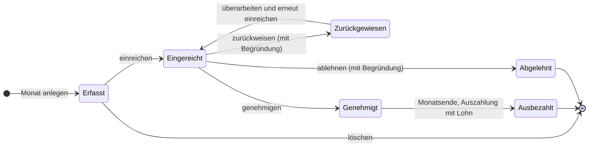

# Zustandsdiagramm: Lebenszyklus eines Spesenantrags

Modelliertes Objekt: ein Spesenantrag (Monatsabrechnung einer mitarbeitenden Person).
Grundlage ist unser Diagramm aus DTR II (`dtr2/Spesenportal-UML.pdf`, Seite 4), mit zwei Korrekturen
(siehe unten). Im Code steht dieselbe Tabelle an einer Stelle:
`backend/src/antraege/statusregeln.ts` (durchgesetzt) und `frontend/src/regeln.js` (Knöpfe ein- und ausblenden).

GitHub zeigt das folgende Mermaid-Diagramm direkt als Grafik an.

## Zulässige Übergänge

| Von | Nach | Ereignis | Wer | Bedingung | API-Endpunkt |
| --- | ---- | -------- | --- | --------- | ------------ |
| – | Erfasst | Monat anlegen | Mitarbeitende | noch keine Abrechnung für diesen Monat | `POST /antraege` |
| Erfasst | – (gelöscht) | löschen | Mitarbeitende | nur im Zustand Erfasst | `DELETE /antraege/:id` |
| Erfasst | Eingereicht | einreichen | Mitarbeitende | jede Position hat Datum, Betrag, Zweck, Beleg; eine vorgesetzte Person ist zugeordnet | `POST /antraege/:id/einreichen` |
| Eingereicht | Genehmigt | genehmigen | Vorgesetzte (eigenes Team) | – | `POST /freigabe/antraege/:id/genehmigen` |
| Eingereicht | Zurückgewiesen | zurückweisen | Vorgesetzte (eigenes Team) | Begründung mind. 5 Zeichen | `POST /freigabe/antraege/:id/zurueckweisen` |
| Eingereicht | Abgelehnt | ablehnen | Vorgesetzte (eigenes Team) | Begründung mind. 5 Zeichen | `POST /freigabe/antraege/:id/ablehnen` |
| Zurückgewiesen | Eingereicht | erneut einreichen | Mitarbeitende | wie beim Einreichen | `POST /antraege/:id/einreichen` |
| Genehmigt | Ausbezahlt | als ausbezahlt markieren | Lohnbuchhaltung | einzeln oder ganzer Monat | `POST /lohnbuchhaltung/abrechnungen/:id/ausbezahlt`, `POST /lohnbuchhaltung/monat/ausbezahlt` |

**Endzustände:** Ausbezahlt und Abgelehnt. **Bearbeitbar** (Positionen, Belege): nur Erfasst und Zurückgewiesen.

## Unzulässige Übergänge

Alle anderen Wechsel sind nicht vorgesehen, z. B. einen genehmigten Antrag zurückweisen, einen
abgelehnten Antrag erneut einreichen, einen nicht genehmigten Antrag auszahlen oder einen ausbezahlten
Antrag ein zweites Mal markieren. Die Anwendung verhindert sie zweifach:

- **Oberfläche:** Die Knöpfe für nicht erlaubte Aktionen werden gar nicht angezeigt (`frontend/src/regeln.js`).
- **Logik:** Das Backend prüft jeden Wechsel gegen die Tabelle oben und antwortet mit `409 Conflict`
  (`statusWechseln()` in `backend/src/antraege/statuswechsel.ts`). Das Update greift nur, wenn der Antrag
  noch im erwarteten Status ist; ein Doppelklick erzeugt deshalb keinen zweiten Wechsel.

Jeder Wechsel wird mit Zeitpunkt, Person und Rolle im Verlauf gespeichert (Tabelle `StatusAenderung`)
und in der Detailansicht angezeigt.

## Korrekturen gegenüber DTR II

1. Im DTR-II-Diagramm begann der Pfeil «ablehnen» auf der Linie zwischen «Erfasst» und «Eingereicht».
   Gemeint war immer: Ablehnen ist nur aus «Eingereicht» möglich. Das ist jetzt eindeutig gezeichnet.
2. Der Übergang «löschen» (nur aus «Erfasst») war im DTR-II-Diagramm nicht eingezeichnet, ist aber
   nötig, damit ein versehentlich angelegter Monat wieder entfernt werden kann.
3. Die Beschriftungen «zurückweisen» und «überarbeiten und erneut einreichen» überlagerten sich im
   PDF; sie stehen jetzt getrennt an den beiden Pfeilen.
